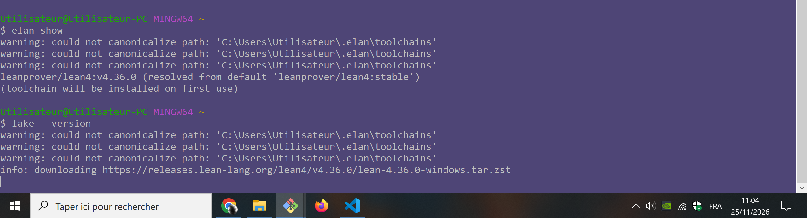

# Lean it all

Here we created manually, file by file, a new lean project, and we build it.

The purpose of a lean project is to perform a formal verification of the validity of a mathematical proof, written in the lean language.

In this example, oour lean project will perform the formal verification of the proof that the sum of two integers that are divisible by 3 , gives a new integer which also is divisible by 3.

The lean code performing the formal verification of that very simle proof is lne by line explained [in `./TintinEtMilouEtChang/Haddock.md`](./TintinEtMilouEtChang/Haddock.md): That will be you first dive into lean language.

## Install elan

## Create a project entirely manually from scratch (zero tools)

```bash
elan show
# tells elan which compiler version to use
cat <<EOF >./lean-toolchain
leanprover/lean4:stable
EOF

# tells the "lake" buildtool, what to compile
# This configuration file registers your project as a package and declares a library target named "TintinEtMilou" (which tells lake to look for MyMath.lean
cat <<EOF >./lakefile.toml
name = "nimportequoi"
version = "0.1.0"
defaultTargets = ["TintinEtMilouEtChang"]

[[lean_lib]]
name = "NexistePas"

[[lean_lib]]
name = "TintinEtMilouEtChang"

[[lean_lib]]
name = "BouleEtBill"
EOF


# in the *.lean files, your definitions and theorems

export TINTIN_TARGET_NAME="TintinEtMilouEtChang"
########## One Source file at root : the "${TINTIN_TARGET_NAME}.lean" named after same name as the target yu will give to the lake build command. The default target name is configured in the lakefile.toml


cat <<EOF >./${TINTIN_TARGET_NAME}.lean
import ${TINTIN_TARGET_NAME}.whatthefreak
import ${TINTIN_TARGET_NAME}.Castafiore
import ${TINTIN_TARGET_NAME}.Tournesol
import ${TINTIN_TARGET_NAME}.Haddock
EOF


########## All other *.lean files must be in the "./${TINTIN_TARGET_NAME}" subfolder 

mkdir -p ./${TINTIN_TARGET_NAME}/


cat <<EOF >./${TINTIN_TARGET_NAME}/whatthefreak.lean
def EstDivisibleParTrois (n : Nat) : Prop :=
  ∃ k : Nat, n = 3 * k

EOF

cat <<EOF >./${TINTIN_TARGET_NAME}/Tournesol.lean
def EstDivisibleParQuatre (n : Nat) : Prop :=
  ∃ k : Nat, n = 4 * k
EOF


cat <<EOF >./${TINTIN_TARGET_NAME}/Haddock.lean
import TintinEtMilouEtChang.whatthefreak

theorem div3_add (a b : Nat) (ha : EstDivisibleParTrois a) (hb : EstDivisibleParTrois b) :
    EstDivisibleParTrois (a + b) := by
  obtain ⟨k, hk⟩ := ha
  obtain ⟨m, hm⟩ := hb
  rw [hk, hm]
  refine ⟨k + m, ?_⟩
  rw [Nat.mul_add]

EOF

# just one empty source file
cat <<EOF >./${TINTIN_TARGET_NAME}/Castafiore.lean
EOF


```

* Note I have created similarly the `BouleEtBill.lean` root source file and `./BouleEtBill/` folder with source files inside: 
  * In the `lakefile.toml` main cofniguration file, each `[[lean_lib]]` section defines hat is called a _"build target"_ in the `lake` cli terminology.
  * Each  _"build target"_ has a name, and you can think of it as a set of source files which will be compiled as one lean library.
  * I have configured 3 such lean libraries: 2 which actually will build because all required files are there, and one called `NexistePas` which will not build because the required files are not there.

* Basically, the rules to follow to add a new library named `Sherazade`: 
  * at root, you must create a folder of path `./Sherazade/`, and a file named exactly `Sherazade.lean`
  * add as many `*.lean` files inside the `./Sherazade/` folder
  * import all `*.lean` files inside the `./Sherazade/` folder, in the `Sherazade.lean` file at root of this repo, with `import Sherazade.<name of file>.lean` instructions for each of them.
  * add a `[[lean_lib]]` section, with `name = "Sherazade"` property in the `lakefile.toml` configuration file:

```toml
name = "nimportequoi"
version = "0.1.0"
defaultTargets = ["TintinEtMilouEtChang"]

[[lean_lib]]
name = "NexistePas"

[[lean_lib]]
name = "TintinEtMilouEtChang"

[[lean_lib]]
name = "BouleEtBill"

[[lean_lib]]
name = "Sherazade"

```

* Then run a first time a `lake` comamnd, which will actually install stuff you need to run the lake commands:

```bash
lake --version
```

This is how it looks as I tied first running it  in git bash for windows (without adminsitrator privileges):



And after a couple of minutes I see it is indeed proceeding (its not blocked or somthg):


* And now that all is installed, you can happily compile your lean project:

```bash
lake clean && lake build

lake clean && lake build BouleEtBill

lake clean && lake build TintinEtMilouEtChang

# Will of course fail:
# lake clean && lake build NexistePas

# When you want to experience building a new library from scratch:
# lake clean && lake build Sherazade

```

And here is an example output:

```bash

Utilisateur@Utilisateur-PC MINGW64 ~/leanitall (feature/spin/up)
$ lake clean && lake build
✔ [2/12] Built TintinEtMilouEtChang.whatthefreak (880ms)
✔ [4/12] Built TintinEtMilouEtChang.Castafiore (871ms)
✔ [6/12] Built TintinEtMilouEtChang.Tournesol (880ms)
✔ [8/12] Built TintinEtMilouEtChang.Haddock (564ms)
✔ [10/12] Built TintinEtMilouEtChang (543ms)
Build completed successfully (12 jobs).

Utilisateur@Utilisateur-PC MINGW64 ~/leanitall (feature/spin/up)
$ lake clean && lake build BouleEtBill
✔ [2/12] Built BouleEtBill.whatthefreak (611ms)
✔ [4/12] Built BouleEtBill.Castafiore (604ms)
✔ [6/12] Built BouleEtBill.Tournesol (619ms)
✔ [8/12] Built BouleEtBill.Haddock (579ms)
✔ [10/12] Built BouleEtBill (553ms)
Build completed successfully (12 jobs).

Utilisateur@Utilisateur-PC MINGW64 ~/leanitall (feature/spin/up)
$ lake clean && lake build TintinEtMilouEtChang
✔ [2/12] Built TintinEtMilouEtChang.whatthefreak (615ms)
✔ [4/12] Built TintinEtMilouEtChang.Castafiore (609ms)
✔ [6/12] Built TintinEtMilouEtChang.Tournesol (614ms)
✔ [8/12] Built TintinEtMilouEtChang.Haddock (635ms)
✔ [10/12] Built TintinEtMilouEtChang (559ms)
Build completed successfully (12 jobs).


```

Ouaf Ouaf, bravo milou!

* To check the lean 4 language syntax in one single file you can do this:

```bash
lake env lean path/to/my/file.lean
```

## ANNEX: VS code issues

You might have errors reported by yhe VScode lean 4 extension. to solve that, here one thing you can do:

* `Ctrl + Maj + P` to access VScode command palette
* Then type `Lean 4: Restart File` in the field,
* And press enter to validate.

You can also try :

* `Ctrl + Maj + P` to access VScode command palette
* Then type `Lean 4: Restart File` in the field,
* And press enter to validate.

And restart your VSCode.

It should now be clean: at any rate, `lake clean && lake build` will always make it clear whether the compilation passes or not.

## Final thoughts

Lean only perform the verification of that proof: The one who writes the lean code is the one who knows and decides WHICH proof he wants to check.

This leans that if an AI writes the lean code, well how do you know what proof you are verifying when you compile it by running the `lake build` command ?

Turning the lean code into a human readable mathematical proof is something else, and if it is thousands of pages, well it will take some time before you can be sure of what the freak is that sequence of chained mathematical assertions.

Turning proof that we already know of , in lean code is one thing, guessing what proof is actually verified by a super long lean code written by AI is something completey different, if it actually ever proves to be relevant.

What is interestng though, as I heard, is finding with AI counter examples which can invalidates a conjecture: taing that example and verifying it breaks the conjecture is fast, that is therfore interesting.

In a future realease, we will look into:

* Building a bit more complex proofs (still not using `Mathlib`)
* Trying to find tools to automatically turn those into human readable mathematical texts (latex maybe ?)

So, now that you know how to write and compile lean **WITHOUT** AI, what do you think is a proof of 13 millions lean code lines, all written by an AI ?

Is it a mathematical proof writtent and understood by the person who operates the AI doing that ?

I leave it to your judgement.

Have fun.

A paper, a pen, and just math, that my love.
