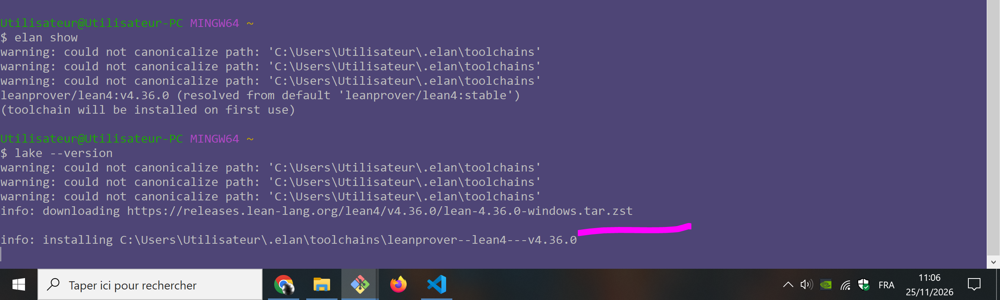

# Lean it all

## Install elan

## Create a project entirely manually from scratch (zero tools)


```bash
elan show
# tells elan which compiler version to use
cat <<EOF >./lean-toolchain
leanprover/lean4:stable
EOF

# tells the "lake" buildtool, what to compile
# This configuration file registers your project as a package and declares a library target named "TintinEtMilou" (which tells lake to look for MyMath.lean
cat <<EOF >./lakefile.toml
name = "nimportequoi"
version = "0.1.0"
defaultTargets = [
  "whatthefreak",
  "Castafiore",
  "Tournesol",
  "Haddock"
]

[[lean_lib]]
name = "TintinEtMilou"
EOF

# in the *.lean files, your definitions and theorems
cat <<EOF >./whatthefreak.lean
def EstDivisibleParTrois (n : Nat) : Prop :=
  ∃ k : Nat, n = 3 * k
EOF

cat <<EOF >./Haddock.lean
theorem div3_add (a b : Nat) (ha : EstDivisibleParTrois a) (hb : EstDivisibleParTrois b) :
    EstDivisibleParTrois (a + b) := by
  obtain ⟨k, hk⟩ := ha
  obtain ⟨m, hm⟩ := hb
  rw [hk, hm]
  use k + m
  rw [Nat.mul_add]
EOF

cat <<EOF >./Castafiore.lean
EOF
cat <<EOF >./Tournesol.lean
EOF


```

* Then run a first time a `lake` comamnd, which will actually install stuff you need to run the lake commands:

```bash
lake --version
```

This is how it looks as I tied first running it  in git bash for windows (without adminsitrator privileges):


And after a couple of minutes I see it is indeed proceeding (its not blocked or somthg):



* And now that all is installed, you can happily compile your lean project:

```bash
lake build
```

Ouaf Ouaf, bravo milou!

* To compile a single file:

```bash
lake env lean path/to/my/file.lean
```
